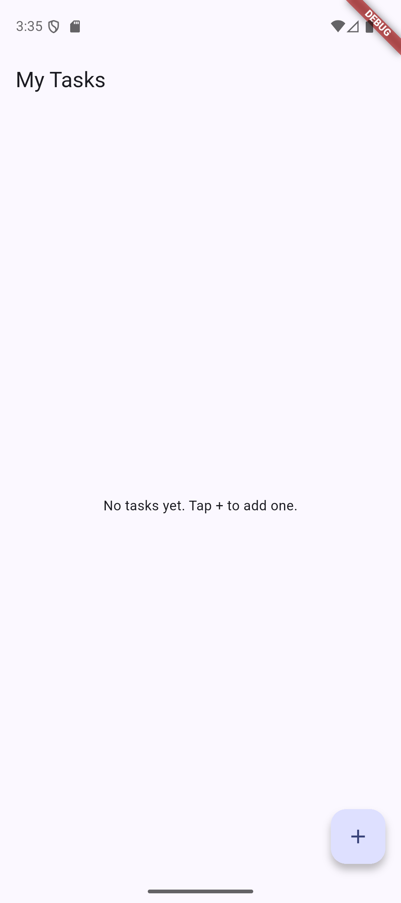
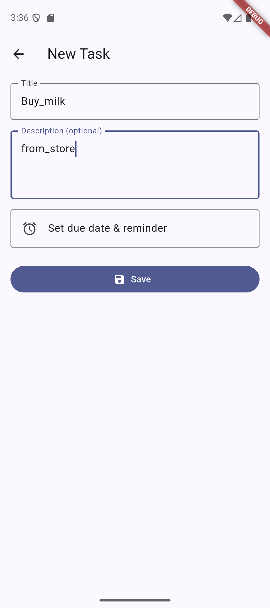
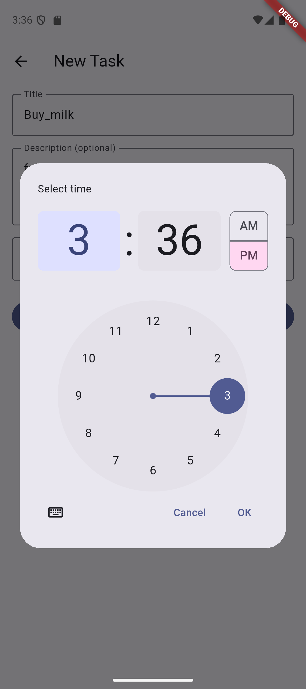
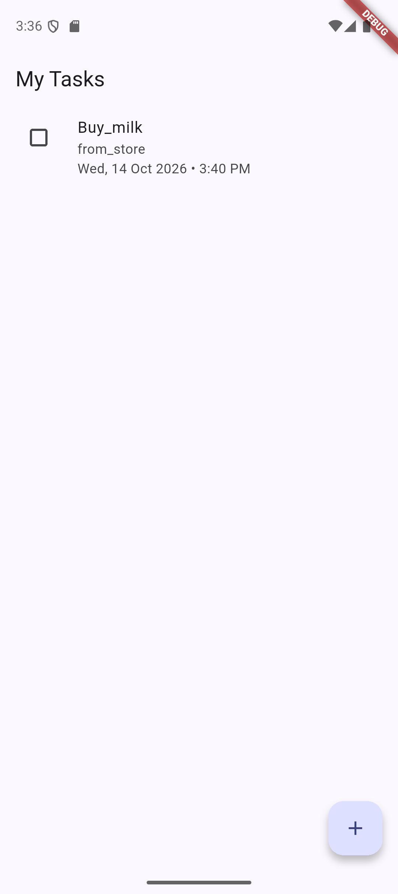
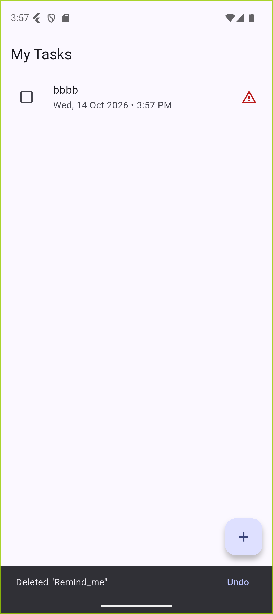

# Task Manager

A simple Flutter mobile app to **add, update, delete and schedule tasks**, with tasks stored locally in **SQLite** and **reminder notifications** at each task's due time. Works fully offline.

## Features

- Add tasks with a title, optional description and optional due date and time
- Edit any task by tapping it
- Mark tasks as done with a checkbox
- Swipe left to delete, with an **Undo** option
- Pending tasks are sorted by due date; overdue tasks show a warning icon
- Local notification at the due time (exact alarm when permitted, inexact fallback)
- Data persists in a local SQLite database (`sqflite`)

## Screenshots

| Empty | Add task | Pick time | Task list | Delete + Undo |
|---|---|---|---|---|
|  |  |  |  |  |

## Tech stack

- Flutter 3.44 / Dart 3.12, Material 3
- `sqflite` + `path` for SQLite storage
- `flutter_local_notifications`, `timezone`, `flutter_timezone` for scheduled reminders
- `intl` for date formatting

## Project structure

```
lib/
  main.dart                          # entry point, theme, notification init
  models/task.dart                   # Task model (to/from SQLite map)
  services/database_helper.dart      # SQLite CRUD
  services/notification_service.dart # schedule / cancel reminders
  screens/home_screen.dart           # task list
  screens/task_form_screen.dart      # add / edit form
docs/                                # mini-project report and screenshots
```

## Getting started

```bash
git clone https://github.com/premdoba/Task-Manager-Project.git
cd Task-Manager-Project
flutter pub get
flutter run
```

Requirements: Flutter SDK, Android Studio / Android SDK, and an emulator or Android device (Android 6.0+).

## Android notes

- Notification permission (Android 13+) is requested on first launch.
- Exact reminders need the "Alarms & reminders" permission (`SCHEDULE_EXACT_ALARM`); without it reminders may arrive a few minutes late.
- The plugin's `ScheduledNotificationReceiver` and `ScheduledNotificationBootReceiver` are declared in `AndroidManifest.xml`; without them scheduled notifications are silently dropped.
- Core library desugaring is enabled in `android/app/build.gradle.kts`.
- If the emulator is low on storage, build a smaller APK: `flutter build apk --release --target-platform android-x64`.

## Tests

```bash
flutter test
```

## Documentation

The mini-project report is in [`docs/Task_Manager_Mini_Project_Report.docx`](docs/Task_Manager_Mini_Project_Report.docx).
